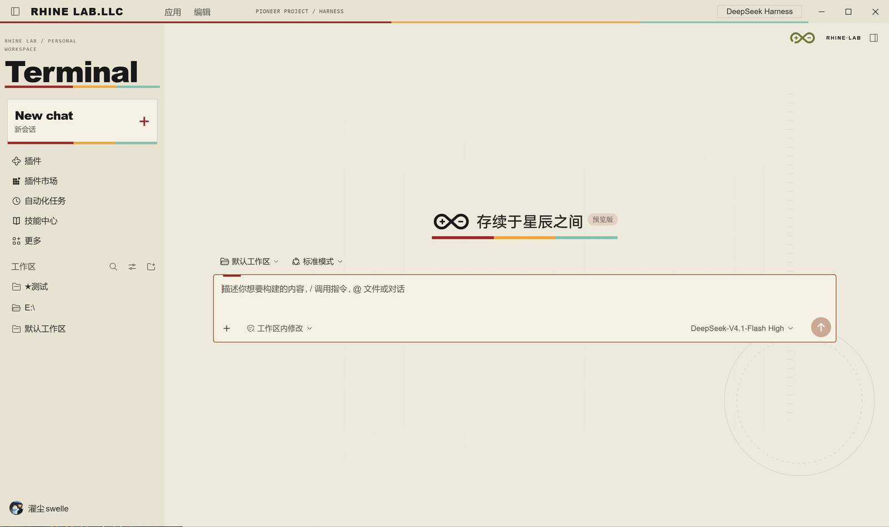

# 莱茵生命 · DeepSeek Harness 主题（重制版）

> **重制版说明**：本仓库基于 [Galaxy-2001/Rhine-Lab-Codex-Theme](https://github.com/Galaxy-2001/Rhine-Lab-Codex-Theme)（MIT）重制，自 1.0.0 起独立维护。原项目的皮肤结构、SVG 素材与工具链是本项目的起点；按 MIT 协议保留原版权声明，见 `LICENSE` 与 `THIRD_PARTY_NOTICES.md`。

一套给 **DeepSeek Harness** 用的非官方同人主题：奶油白 / 石墨黑终端版面、莱茵生命 ∞ 标志、三色细边与等宽小字。两套皮肤（原色 / 明色），亮暗自适应。



## 内容结构

```
dsh/                插件本体（package.json、lib/、skins/、scripts/、tests/）
dsh/docs/           审计记录、验证记录、发版流程、市场截图
dsh/SECURITY.md     安全说明：写入范围、无联网证明、自查命令
LICENSE             代码 MIT（含上游版权声明）
THIRD_PARTY_NOTICES.md  上游项目与第三方依赖声明
```

## 安装

插件包：`dsh-rhine-lab-theme-1.0.0.tgz`

```bash
# 官方桌面版
dsh plugin --profile desktop add "D:\Downloads\dsh-rhine-lab-theme-1.0.0.tgz"

# 或：DSH 里进入「插件 → 添加插件」，填 tarball 的完整路径
```

装好后点「立即启用」，插件会自动把两个皮肤写入 `$DSH_HOME/skins/` 并在皮肤中心选中「莱茵生命」。详细说明见 [dsh/README.md](dsh/README.md)。

## 安全

- 纯本地渲染：无联网、无命令执行、无遥测、无安装期脚本；
- 写入范围仅限 `$DSH_HOME` 下的皮肤目录与两个状态文件；
- 17 项检查逐条实测，附可复现的自查命令：[SECURITY.md](dsh/SECURITY.md) · [审计记录](dsh/docs/AUDIT.md)。

## 推荐搭配

截图里每条回复左侧的角色头像和 ID 来自第三方插件 **dsh-avatar-frame**（MIT，未随本包分发）：

```bash
dsh plugin --profile desktop add dsh-avatar-frame
```

## 兼容性

DeepSeek Harness 桌面版 0.2.2-rc.3 + 皮肤中心 0.4.5 实测。依赖 [dsh-skins](https://github.com/zhu1090093659/dsh-skins) 皮肤中心（Apache-2.0）加载皮肤，插件已声明该依赖。

## 许可与致谢

代码 MIT。莱茵生命、《明日方舟》相关标志归属权利方，本主题为非官方同人作品。

- 上游：[Galaxy-2001/Rhine-Lab-Codex-Theme](https://github.com/Galaxy-2001/Rhine-Lab-Codex-Theme)（MIT）
- 皮肤格式与加载：[dsh-skins](https://github.com/zhu1090093659/dsh-skins)（Apache-2.0）
