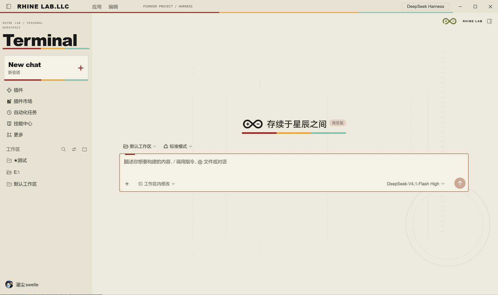
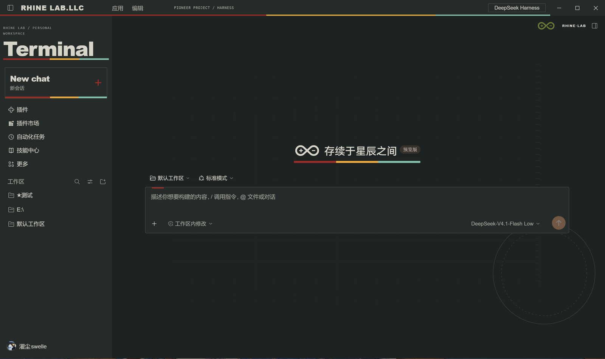

# Rhine Lab · DeepSeek Harness theme (rebuild)

> **Rebuild notice**: this plugin is rebuilt from [Galaxy-2001/Rhine-Lab-Codex-Theme](https://github.com/Galaxy-2001/Rhine-Lab-Codex-Theme) (MIT) and has been maintained independently since 1.0.0. The upstream skin structure, SVG artwork and tooling are its starting point; the original copyright notice is preserved under the MIT license, see `LICENSE` and `THIRD_PARTY_NOTICES.md`.


> **Security & audit**: what it writes, the no-network/no-telemetry evidence and copy-paste verification commands live in [SECURITY.md](SECURITY.md); the itemised audit is in [docs/AUDIT.md](docs/AUDIT.md).

Version **1.0.0** (rebuild) keeps the Pioneer terminal design: cream and graphite surfaces, bold Terminal lettering, a bilingual New chat card, circular instrument marks and a three-color edge. Changes from upstream: the central animated watermark behind body copy is gone (artwork kept in the package), the Rhine Lab mark sits in the header next to the more button, user bubbles hug their content, and a second lighter skin ships alongside.

Light-mode titlebar and native Windows caption buttons share the same background. The badge spells out **DeepSeek Harness**. The sidebar toggle stays in its original position and no longer covers the window; normal input and control hit targets are preserved. Existing tooltip and billing-period contrast fixes remain.

[96-second native desktop demo](https://github.com/Galaxy-2001/Rhine-Lab-Codex-Theme/releases/tag/demo-2026-10-30)

The screenshots below were captured in the DeepSeek Harness desktop client. Account details and avatars are masked. The header mark and the infinity on the empty Session use the artwork's own travelling-gap animation (one lap every 6s, flat cut ends); the central animated watermark has been removed.





Build the tarball with `npm run build` (it lands in `dist/`). The Skin ZIP is for manual installation when Skin Center is already present; the Source ZIP is for development.

Download `dsh-rhine-lab-theme-1.0.0.tgz`. In official DSH Desktop, open Plugins > Add plugin, enter the tarball's absolute local path and install. After installation, click Enable now. The plugin declares Skin Center as a dependency, installs its artwork on first activation and selects Rhine Lab automatically. Later launches preserve your choices. Keep using the ordinary DSH application shortcut. The package has not been published to npm yet.

For Web, run `dsh plugin --profile web add "C:\Downloads\dsh-rhine-lab-theme-1.0.0.tgz"`, then start the host with `dsh web`. A refused connection at port 3080 means the host is not running; installing a theme does not start a persistent web host. Do not use the ordinary CLI to mutate Desktop's reserved profile.

For an asset-only installation with Skin Center already present, copy the Skin ZIP's `rhine-lab` directory into `$DSH_HOME/skins/` and select Rhine Lab in Settings > Skin Center.

The Source ZIP also contains a Node.js installer: `node scripts/install.mjs`. Updates back up the previous skin. The installer respects `DSH_SKINS_HOME`, `DSH_SKINS_DIR` and `DSH_HOME`, and leaves the current selection unchanged. Select the skin in the GUI afterwards.

For a web profile without the loader:

```text
dsh plugin --profile web add @linxin666/dsh-client-ui-skin-center@0.4.5
```

Restart the host yourself after adding the loader. DSH Desktop manages its own profile: install the package through its plugin manager. Subsequent asset installation and skin switching do not need a host restart.

Tested on the DeepSeek Harness desktop client 0.2.2-rc.3 with Skin Center 0.4.5. DSH includes prereleases in its runtime compatibility check; no exemption is needed. Development dependencies use 0.1.7-rc.1 to satisfy npm's default peer resolution. Using the skin does not require downgrading DSH. See the validation record for tested coverage.

This is a v2 asset skin, with L1 tokens and L2 semantic surfaces. It contains no executable hooks, remote assets or client patcher. SVG animation follows reduced-motion preferences. Skin Center owns background switches and blur controls.

Choose Official default in Skin Center to restore the original appearance. Then remove `$DSH_HOME/skins/rhine-lab` if you want to uninstall the assets.

Development: `npm ci --ignore-scripts`, `npm test`, `npm run generate`, `npm run build`. The installable plugin TGZ, asset and source ZIPs, and SHA-256 sums appear in `dist/`. See [validation](docs/VALIDATION.md) for tested coverage. Marketplace metadata may refresh separately; Releases provide the current package.

Theme code is MIT licensed. Rhine Lab and related Arknights marks belong to their rights holders. This is an unofficial fan theme; its code licence does not grant brand rights.

## Companion plugin: dsh-avatar-frame

The **character avatar and ID** beside each reply in the screenshots come from **dsh-avatar-frame** — a separate third-party plugin (MIT) that this package does not ship. It adds an avatar per reply, an editable ID and read-aloud through the system voice or your own TTS service.

**Install it in one of three ways**

1. **Plugin market**: open the DSH plugin market, search `dsh-avatar-frame`, install;
2. **CLI**:
   ```bash
   dsh plugin --profile desktop add dsh-avatar-frame
   ```
3. **npm**: <https://www.npmjs.com/package/dsh-avatar-frame> — currently `0.14.2`, the version the screenshots were taken with.

Source: <https://github.com/vioeveann/dsh-avatar-frame>.

It is optional: the theme works without it, you just lose the avatars.

## Retained billing and dark-mode fixes

Off-peak billing periods use blue with stripes, peak periods use amber, and weekends use green. Dark chat text, cards and background artwork are softer. Billing logic is unchanged.

## Contributions and acknowledgements

- **[Galaxy-2001](https://github.com/Galaxy-2001)**: project initiator and maintainer; design direction, requirements, reference materials, hands-on validation, visual feedback and release decisions.
- **[OpenAI Codex](https://github.com/codex) (AI development assistant)**: implemented most of the code under the maintainer's direction and feedback, and contributed to visual design, 3D SVG animation, Codex and DSH integration, fixes, testing, packaging, documentation, demo materials, GitHub releases and the marketplace submission.

The project was developed collaboratively by its maintainer and an AI assistant. This credit records development contributions and does not imply an official OpenAI project or endorsement.

Codex-assisted commits use `Co-authored-by: Codex <noreply@openai.com>` to record commit-level credit alongside the maintainer. Earlier published commits retain their original history.
